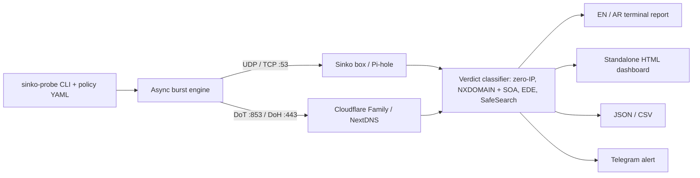

# 🛡️ sinko-probe

[](https://github.com/iret33/sinko-probe/actions)
[](https://www.python.org/)
[](LICENSE)
[](https://github.com/iret33/sinko)

**A multi-protocol DNS traffic simulator, SafeSearch auditor and benchmark suite built for
[Sinko](https://github.com/iret33/sinko), the bilingual (Arabic/English) home parental-control
appliance for a calmer family internet. It works against any DNS filter: Pi-hole, AdGuard Home,
Cloudflare for Families, Quad9, NextDNS and others.**

Instead of checking a flat list of domains, `sinko-probe` replays what real apps look up (YouTube,
TikTok, Roblox, Smart-TV ACR telemetry, AI chatbots, school sites) as bursts of DNS queries. It
then checks three things: that what should be blocked is blocked, that search engines are forced
into SafeSearch, and that school and reference sites still work.

---

## ✨ What it checks

- **Four transports:** plain DNS over UDP (with automatic TCP retry on truncation) and TCP, DNS-over-TLS
  ([RFC 7858](https://www.rfc-editor.org/rfc/rfc7858)) and DNS-over-HTTPS
  ([RFC 8484](https://www.rfc-editor.org/rfc/rfc8484)). TLS certificates are **verified by
  default**. `--ca-file` trusts your Sinko box's own CA, and `--insecure` turns checking off.
- **Every common way a filter blocks:** `0.0.0.0`/`::`, NXDOMAIN, NODATA, REFUSED, block-page IPs
  (`--sinkhole-ip`, CIDRs allowed), and [RFC 8914](https://www.rfc-editor.org/rfc/rfc8914)
  Extended DNS Errors (*Blocked*, *Censored*, *Filtered*).
- **No false credit:** a real "this name does not exist" answer (NXDOMAIN carrying the parent
  zone's SOA, with no filtering EDE) counts as *inconclusive*, not as a block. So dead domains and
  random `--cache-bust` labels cannot inflate the score.
- **SafeSearch and YouTube Restricted Mode** for Google, YouTube, Bing and DuckDuckGo. A CNAME
  passes if it is the marker name or a subdomain of it, and an IP marker must match exactly.
  Substrings never count, so `strict.bing.com.evil.example` does not pass.
- **Schedule policies** such as *Homework Mode*: per-category rules plus custom block/allow lists.
  Every listed domain is probed, even if no profile mentions it.
- **Head-to-head benchmarks** (`compare`) on compliance, block rate, SafeSearch, over-blocking,
  errors and p50/p95 latency. Each target can use its own transport.
- **Reports:** an English or Arabic terminal report (`--lang ar`), a standalone HTML dashboard
  (works offline, responsive, light/dark, RTL), JSON, CSV and Telegram alerts.



---

## 🚀 Quick start

```bash
git clone https://github.com/iret33/sinko-probe.git
cd sinko-probe
pip install -e ".[dev]"
```

### 1. Audit your Sinko box

```bash
# English terminal report plus a standalone HTML dashboard
sinko-probe run --server 192.168.1.2 --name "Sinko Home" --html audit.html

# Arabic terminal and HTML reports
sinko-probe run --server 192.168.1.2 --name "سينكو" --lang ar --html audit-ar.html
```

### 2. Benchmark Sinko against public family resolvers

```bash
sinko-probe compare \
  --target "Sinko=192.168.1.2" \
  --target "CloudflareFamily=tls://1.1.1.3" \
  --target "CloudflareFamilyDoH=https://family.cloudflare-dns.com/dns-query" \
  --target "Quad9=9.9.9.9"
```

### 3. Check a Homework Mode schedule

```bash
sinko-probe run \
  --server 192.168.1.2 \
  --policy configs/sinko-homework-policy.yaml \
  --min-score 95
```

### 4. Cron audit with a Telegram alert

```bash
export SINKO_TELEGRAM_TOKEN="123456:ABC-DEF..."
export SINKO_TELEGRAM_CHAT_ID="987654321"

sinko-probe run --server 192.168.1.2 --no-jitter --min-score 90
```

The alert is sent before the exit code is decided, so you still hear about it when the box is
unreachable. The bot token never appears in error messages.

### 5. Docker

```bash
docker build -t sinko-probe .
docker run --rm --user "$(id -u):$(id -g)" -v "$PWD:/reports" \
  sinko-probe run --server 192.168.1.2 --html /reports/audit.html
```

---

## 🔌 Resolver addresses

`--server` (and the right-hand side of `compare --target Name=...`) accepts:

| Form | Example | Transport |
| --- | --- | --- |
| IP | `192.168.1.2`, `2606:4700:4700::1113` | `--proto` (default `udp`) |
| IP and port | `192.168.1.2:5353`, `[::1]:5353` | `--proto` |
| Hostname | `sinko.local` | `--proto`; resolved with the system resolver first |
| `tcp://` | `tcp://192.168.1.2` | TCP |
| `tls://` | `tls://1.1.1.3`, `tls://family.cloudflare-dns.com` | DNS-over-TLS (port 853) |
| `https://` | `https://dns.nextdns.io/abc123` | DNS-over-HTTPS (default path `/dns-query`) |

A port written in the address wins over `--port`. For DoT to an IP whose certificate only names
a host, pass `--tls-server-name`.

## 🧪 How each answer is judged

| Verdict | When |
| --- | --- |
| `BLOCKED (Zero/Loopback IP)` | The answer contains `0.0.0.0`, `::` or a loopback address |
| `BLOCKED (Sinkhole VIP)` | An answer IP is in `--sinkhole-ip`, or the resolver tagged a real-looking IP with a filtering EDE |
| `BLOCKED (NXDOMAIN)` | NXDOMAIN with no upstream SOA, or with a filtering EDE |
| `BLOCKED (NODATA)` / `BLOCKED (REFUSED)` | Empty NOERROR answer / REFUSED (unless EDE 18 says the *client* is not allowed) |
| `ENFORCED (SafeSearch)` | The CNAME chain or an IP matches the probe's SafeSearch markers |
| `ALLOWED (Resolved)` | A normal answer |
| `INCONCLUSIVE (Name does not exist)` | NXDOMAIN with the SOA of a parent zone: the name really does not exist |
| `ERROR (...)` | Timeout, SERVFAIL or another failing RCODE, or a connection, TLS or HTTP failure |

Each probe then **passes**, **fails**, is an **error** (no usable answer) or is **inconclusive**.

## 📊 Metrics

| Metric | Definition |
| --- | --- |
| Compliance score | Passed probes ÷ all probes except inconclusive ones. Errors count against it. |
| Block efficacy | Must-block probes that were blocked ÷ must-block probes that got a conclusive answer |
| SafeSearch enforced | SafeSearch probes that were rewritten ÷ SafeSearch probes that got a conclusive answer |
| False positives | Must-allow probes that were blocked ÷ must-allow probes that got a conclusive answer |
| Errors | Probes without a usable answer ÷ all probes |
| Latency p50/p95/p99 | Answered queries only. A timeout would just measure `--timeout`. |

A rate shows `n/a` when nothing of that kind was tested; it never defaults to 100%.

Latency notes: DoH keeps one HTTP/2 connection open for the whole run, like a real client. TCP
and DoT open a new connection per query, so their latency includes the handshake.

## 📜 Policies

```yaml
policy_name: "Sinko Afternoon Homework Mode (3:00 PM - 8:00 PM)"
category_rules:          # ads, telemetry, social, gaming, streaming, safe_search,
  gaming: block          # parental_restricted, ai_chatbots, core_service, custom
  ai_chatbots: block
  safe_search: safesearch
custom_blocklist: ["roblox.com"]         # covers every subdomain
custom_allowlist: ["create.roblox.com"]  # the most specific entry wins
```

- For each probe, the most specific matching custom-list entry decides first, then the category
  rule, then the profile's built-in expectation.
- Every custom-list domain is probed, even if no profile mentions it.
- Unknown keys are rejected, so a typo like `custom_blocklst` is an error, not a silent no-op.
  The same domain in both lists is also rejected.

## 🧩 Custom app profiles

```yaml
# my-profiles.yaml, used with: sinko-probe run --config my-profiles.yaml --app home_iot
profiles:
  - id: home_iot
    name: Home IoT
    name_ar: أجهزة المنزل الذكية
    burst_interval_ms: [20, 120]
    probes:
      - { domain: telemetry.vendor.example, category: telemetry }   # expected: block (default)
      - { domain: firmware.vendor.example, category: core_service, expected: allow }
      - { domain: www.bing.com, category: safe_search, expected: safesearch,
          expected_cname_markers: [strict.bing.com, 204.79.197.220] }
```

`sinko-probe list-profiles --config my-profiles.yaml` shows what will run.

## 🃏 Wildcard checks (`--cache-bust`)

`--cache-bust` queries a random label (`sinkoprobe-x7k2q9ab.ads.tiktok.com`) under every
**must-block** domain. This checks that subdomains are blocked too, and the answer cannot come from
cache. Allowed and SafeSearch probes keep their real names, since random names under them simply
do not exist. If the filter has no wildcard rule, the upstream NXDOMAIN shows up as
*inconclusive*, not as a block.

## 🚦 Exit codes

| Code | Meaning |
| --- | --- |
| `0` | Success |
| `1` | Compliance score below `--min-score` |
| `2` | Invalid usage or configuration (bad flag, address, policy or profile file) |
| `3` | The resolver could not be reached (no usable answer at all, or its hostname did not resolve) |

---

## 🛠️ Development

```bash
make install   # pip install -e ".[dev]"
make check     # ruff check, ruff format --check, pytest
```

The tests run a small DNS server in the test process over real UDP, TCP, DNS-over-TLS (with a
throwaway CA from [`trustme`](https://pypi.org/project/trustme/)) and DNS-over-HTTPS, so every
transport is exercised end to end. CI runs Python 3.10–3.14, a job pinned to the minimum
dependency versions declared in `pyproject.toml`, and a Docker build.

## 📄 License

Released under the [MIT License](LICENSE). Built with pride as part of the
[Sinko](https://github.com/iret33/sinko) ecosystem.
