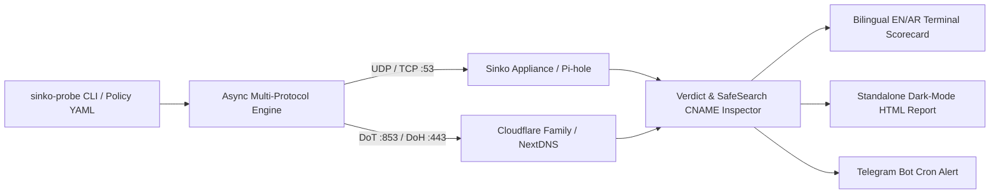

# 🛡️ sinko-probe

[](https://github.com/iret33/sinko-probe/actions)
[](https://www.python.org/)
[](LICENSE)
[](https://github.com/iret33/sinko)

**State-of-the-art multi-protocol DNS traffic simulator, SafeSearch auditor, and benchmark suite built to honor [Sinko](https://github.com/iret33/sinko) — the bilingual (Arabic/English) home parental-control appliance for a calmer family internet.**

Unlike flat domain-list checkers, `sinko-probe` simulates realistic, multi-application DNS query bursts (YouTube, TikTok, Roblox, Smart TV ACR telemetry, and family-safety categories) while verifying **block efficacy**, **SafeSearch CNAME enforcement**, and **zero false-positives** on essential educational domains.

---

## ✨ Architecture & Highlights



- **Multi-Transport Support (`UDP`, `TCP`, `DoT`, `DoH`)**: Audit local resolvers on port `53` or encrypted cloud resolvers via RFC 7858 DNS-over-TLS and RFC 8484 DNS-over-HTTPS.
- **SafeSearch & Restricted Mode Verification**: Inspects DNS `CNAME` chains and virtual IPs to confirm active enforcement of Google SafeSearch (`forcesafesearch.google.com`), YouTube Restricted Mode (`restrict.youtube.com`), Bing Strict, and DuckDuckGo Safe.
- **Head-to-Head Resolver Benchmarking (`compare`)**: Compare your **Sinko** box directly against `1.1.1.3` (Cloudflare Family), `9.9.9.9` (Quad9), or Pi-hole across block rate, false-positives, and **p50 / p95 / p99** latency.
- **Declarative Schedule & Policy Auditing (`--policy`)**: Validate active Sinko modes (e.g., *Homework Mode* vs. *Free Time*) using declarative YAML rules.
- **Bilingual (`EN` / `AR`), HTML Dashboards & Telegram Alerts**: Render tables in English or Arabic (`--lang ar`), export standalone dark-mode HTML dashboards (`--html`), and push automated cron summaries to **Telegram**.

---

## 🚀 Quick Start

```bash
git clone https://github.com/iret33/sinko-probe.git
cd sinko-probe
pip install -e ".[dev]"
```

### 1. Audit Your Sinko Box (with HTML Dashboard & Arabic/English Output)
```bash
# English terminal report + standalone HTML dashboard
sinko-probe run --server 192.168.1.2 --name "Sinko Home" --html audit.html

# Arabic localized terminal report
sinko-probe run --server 192.168.1.2 --name "سينكو" --lang ar
```

### 2. Head-to-Head Benchmark: Sinko vs. Public Family Resolvers
```bash
sinko-probe compare \
  --target "Sinko=192.168.1.2" \
  --target "CloudflareFamily=1.1.1.3" \
  --target "Quad9=9.9.9.9"
```

### 3. Validate a Specific Sinko Homework Schedule Policy
```bash
sinko-probe run \
  --server 192.168.1.2 \
  --policy configs/sinko-homework-policy.yaml \
  --min-score 95
```

### 4. Automated Cron Audit with Telegram Notification
```bash
export SINKO_TELEGRAM_TOKEN="123456:ABC-DEF..."
export SINKO_TELEGRAM_CHAT_ID="987654321"

sinko-probe run --server 192.168.1.2 --no-jitter
```

---

## 📄 License

Released under the [MIT License](LICENSE). Built with pride as part of the [Sinko](https://github.com/iret33/sinko) ecosystem.
